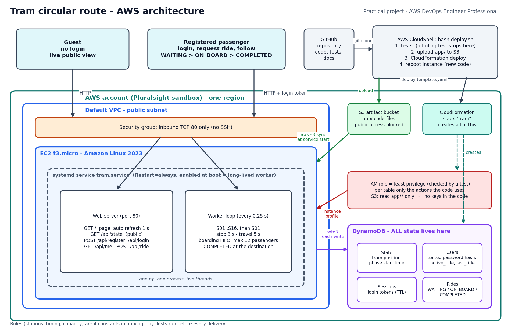
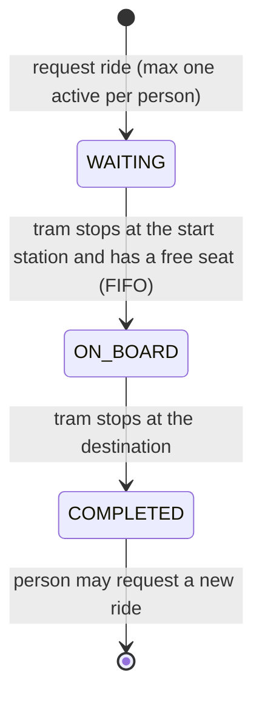

# Architecture

(SVG version: [architecture.svg](architecture.svg). Re-draw with `python3 docs/architecture_diagram.py`.)

## Components

| Part | AWS service | Job |
|---|---|---|
| Infrastructure as code | CloudFormation (`template.yaml`) | creates and owns every resource; one command rebuilds everything |
| Worker + web server | EC2 t3.micro, Amazon Linux 2023, systemd service `tram.service` | one Python process (`app/app.py`): simulation loop every 0.25 s and the HTTP API/page on port 80 |
| State | DynamoDB (4 tables, on-demand) | tram position, accounts, login sessions, rides. Nothing is kept on the instance disk |
| Code delivery | S3 bucket `tram-artifacts-<account>-<region>` | `deploy.sh` uploads `app/`; the service downloads it each time it starts |
| Permissions | IAM role + instance profile | no keys in code; per-table least privilege |
| Network | default VPC, security group | only TCP 80 inbound, no SSH |

## Data model (all tables have the key `pk`)

| Table | `pk` | Important attributes |
|---|---|---|
| State | `tram-1` | `station`, `phase` (STOPPED/TRAVELING), `phase_start_ms` |
| Users | username | `salt`, `pw_hash` (PBKDF2-SHA256), `active_ride`, `last_ride` |
| Sessions | random token | `username`, `expires_at` (DynamoDB TTL) |
| Rides | random id | `rider`, `from_station`, `to_station`, `ride_status`, `created_ms` |

## How the simulation works

- The tram is not "counted" in memory. The state stores **when the current phase started**.
  Remaining time = start + duration - now. After any restart the worker simply continues.
- Every 0.25 s: if the phase is over, a **conditional update** moves the tram (STOPPED -> TRAVELING, or to the next
  station). If two workers ever ran, only one update can win.
- While the tram is stopped at a station, the worker (idempotent, every tick):
  1. sets passengers whose destination is this station to **COMPLETED** and frees their user,
  2. boards **WAITING** passengers of this station in **FIFO** order (earliest request first) until the tram is full.
- After a long outage (more than two phases late) the worker does not replay the missed time.

## Request flow

1. Browser asks `GET /api/state` every second (no login) -> position, direction, remaining time, on board, free seats,
   waiting per station. Passengers appear only as anonymous ids like `P-3FA1`.
2. Registration/login -> password stored as salted hash, session token (24 h TTL) in DynamoDB.
3. `POST /api/ride` -> atomic claim on the user item (`attribute_not_exists(active_ride)`) = maximum one active ride,
   then the ride is stored as WAITING.
4. `GET /api/me` -> own ride, status, ETA, journey path; after arrival the COMPLETED summary.

## Security and permissions (least privilege)

| Table | Allowed actions | Why |
|---|---|---|
| State | GetItem, PutItem, UpdateItem | read position, create it once, advance it |
| Users | GetItem, PutItem, UpdateItem | login, register, claim/free the active ride |
| Sessions | GetItem, PutItem, DeleteItem | login, check token, logout |
| Rides | GetItem, PutItem, UpdateItem, Scan | request, board/complete, public view (only table that is scanned) |
| S3 | GetObject on `app/*`, ListBucket | download the code, nothing else |

`tests/test_permissions.py` compares this list with the real calls in `app.py`: an extra or missing permission fails the tests.
Other measures: password hashing with random salt, no credentials in code (instance role), only port 80 open,
S3 public access blocked, anonymous public view, input validation, IMDSv2 (Amazon Linux 2023 default).

## Decisions and limits

- **EC2 + systemd** instead of Lambda: the assignment asks for a long-lived worker.
- **DynamoDB** instead of files or memory: state must survive restarts.
- Code lives in **S3**, not in the template: EC2 user data is limited to 16 KB and updates become a simple sync + reboot.
- Known limits: HTTP only (no TLS; production would use an ALB with a certificate), a single instance (no high
  availability), the ride list is read with Scan (fine for this size, a GSI would be the next step).
